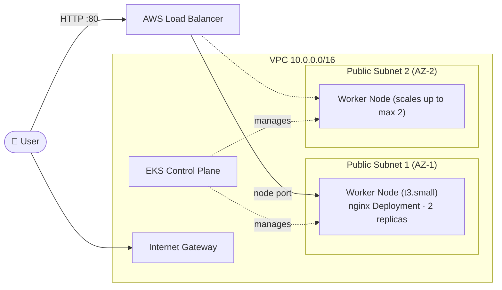

# 🚀 **Deploy an EKS Cluster with Terraform – Like a Boss!**  


---

## 📌 **Project Overview**  


This project uses **Terraform** to provision a complete **Amazon EKS** environment on AWS with **Infrastructure as Code (IaC)**:

🔹 **A VPC** with two public subnets across two Availability Zones, an Internet Gateway and public routing.  
🔹 **A managed EKS cluster** with a managed node group (IAM roles created automatically, names unique per deployment).  
🔹 **A demo workload**: a 2-replica **nginx** Deployment exposed through an AWS **Load Balancer** via a Kubernetes `Service`.  

🔹 **Kubernetes (K8s)** manages containerized applications efficiently.  
🔹 **EKS (Elastic Kubernetes Service)** is a managed K8s solution on AWS.  
🔹 **Terraform** simplifies infrastructure provisioning with reusable modules.  

---

## 🏗️ **Architecture**



---

## 📁 **Project Structure**  

The repository follows a **modular structure** for better organization and reusability:  

```tree
EKS-CLUSTER-TERRAFORM/
│── modules/                   # Terraform modules  
│   ├── eks/                   # EKS module  
│   │   ├── main.tf            # EKS cluster, managed node group, IAM roles  
│   │   ├── variables.tf       # Variables for the EKS module  
│   │   ├── outputs.tf         # Outputs for the EKS module  
│   ├── vpc/                   # VPC module  
│   │   ├── main.tf            # VPC, public subnets, IGW, routing  
│   │   ├── variables.tf       # Variables for the VPC module  
│   │   ├── outputs.tf         # Outputs for the VPC module  
│  
│── .gitignore                 # Git ignore file  
│── .terraform.lock.hcl        # Provider lock file (generated by `terraform init`, committed)  
│── kubernetes.tf              # Demo nginx Deployment + LoadBalancer Service  
│── main.tf                    # Root configuration: wires the VPC + EKS modules together  
│── outputs.tf                 # Root outputs (cluster info, ready-to-run kubectl command)  
│── provider.tf                # Provider versions + AWS/Kubernetes provider configuration  
│── variables.tf               # Root variables (AWS region)  
│── README.md                  # Documentation (this file)  
```

🔹 **`modules/vpc`** – Handles VPC and networking setup, tagged for Kubernetes load-balancer discovery.  
🔹 **`modules/eks`** – Manages the EKS control plane, managed node group and IAM roles.  
🔹 **`provider.tf`** – Provider configuration; the Kubernetes provider authenticates via `aws eks get-token`.  
🔹 **`main.tf`** – Root Terraform script that calls the modules.  
🔹 **`kubernetes.tf`** – Deploys the demo application into the cluster.  
🔹 **`outputs.tf`** – Displays useful deployment details.  

---

## 🎯 **Why Terraform for EKS?**  

✔ **Automated & Repeatable Deployments** – Reduce human error.  
✔ **Infrastructure as Code (IaC)** – Easily track changes.  
✔ **Dependency Awareness** – Ensures resources are created in the correct order.  
✔ **Scalability & Reusability** – Modular design for better maintainability.  

---

## ⚡ **Prerequisites**  

| Tool | Version | Why |
|------|---------|-----|
| ✅ **Terraform** | `>= 1.3` | Provisioning ([download](https://developer.hashicorp.com/terraform/downloads)) |
| ✅ **AWS CLI v2** | latest | Credentials **and** cluster authentication (the Kubernetes provider calls `aws eks get-token`) |
| ✅ **kubectl** | matches cluster | Interacting with the cluster ([install](https://kubernetes.io/docs/tasks/tools/install-kubectl/)) |
| ✅ **AWS Account** | — | With credentials configured via `aws configure` or environment variables |

---

## 🚀 **Deployment Steps**  

### 1️⃣ **Clone the Repository**  

```bash
git clone https://github.com/NotHarshhaa/eks-cluster-terraform
cd eks-cluster-terraform
```

---

### 2️⃣ **Configure the Region (Optional)**  

The default region is `us-east-1`. Change it in [`variables.tf`](variables.tf) or override it when running Terraform:

```bash
terraform plan -var="aws_region=eu-central-1"
```

---

### 3️⃣ **Initialize, Plan & Apply Terraform**  

```bash
terraform init      # Initialize Terraform backend + download providers
terraform plan      # Preview infrastructure changes
terraform apply     # Deploy infrastructure (takes ~15 min for EKS)
```

📌 **Expected Outputs:** EKS cluster name & endpoint, VPC/subnet IDs, and a ready-to-run `configure_kubectl` command.

---

### 4️⃣ **Connect to Your EKS Cluster**  

Configure `kubectl` using the command Terraform printed, or:

```bash
aws eks update-kubeconfig --name <EKS_CLUSTER_NAME> --region <AWS_REGION>
```

Verify the cluster and demo app:

```bash
kubectl get nodes
kubectl get deployment terraform-project102
kubectl get service terraform-project102
```

Grab the load balancer address and open it in your browser:

```bash
kubectl get service terraform-project102 -o jsonpath='{.status.loadBalancer.ingress[0].hostname}'
# → http://<ELB-HOSTNAME>  (may take a few minutes to become available)
```

---

## ⚙️ **Common Configuration Knobs**  

Everything is defined in [`main.tf`](main.tf) and documented in the module `variables.tf` files. The most useful settings:

| Setting | Where | Default |
|---------|-------|---------|
| AWS region | `variables.tf` | `us-east-1` |
| VPC / subnet CIDRs | `main.tf` → `module "vpc"` | `10.0.0.0/16`, 2 × `/24` |
| Node instance type | `main.tf` → `module "eks"` | `t3.small` |
| Node count (desired / min / max) | `main.tf` → `module "eks"` | `1 / 1 / 2` |
| Kubernetes version | `main.tf` → `cluster_version` | latest AWS default |
| SPOT nodes (cheaper) | `main.tf` → `capacity_type` | `ON_DEMAND` |
| Public API access CIDRs | `main.tf` → `public_access_cidrs` | `0.0.0.0/0` |
| SSH access to nodes | `main.tf` → `key_pair` | disabled |

💡 **Enable SSH to nodes** by setting `key_pair` to the name of an existing EC2 key pair. Without a source security group this opens port 22 to `0.0.0.0/0`, so prefer setting `remote_access_source_security_group_ids` too.

---

## 🔒 **Security Notes**  

- The Kubernetes API is publicly reachable from `0.0.0.0/0` for convenience. **Restrict `public_access_cidrs` to your IP** for anything beyond a demo.  
- Worker nodes run in **public subnets** to keep the setup simple. For production, deploy nodes into **private subnets** with NAT.  
- SSH to nodes is **disabled by default**.  
- IAM role names are prefixed with the cluster name, so re-deploying this stack into the same account never collides.  

---

## 🧹 **Destroy the Infrastructure**  

⚠️ **Cost warning:** a running EKS cluster (~$0.10/h), the EC2 nodes and the load balancer all cost money — **destroy when you're done** (~$80+/month if left running).

```bash
terraform destroy
```

Alternatively, if using **Terraform Cloud**, go to: **Settings → Destruction & Deletion → Queue destroy plan.**  

---

## 🔧 **Troubleshooting**  

| Symptom | Likely cause / fix |
|---------|--------------------|
| `aws eks get-token` errors during plan/apply | AWS CLI v1 is too old — install/update to **AWS CLI v2** |
| Service `EXTERNAL-IP` stays `<pending>` | Load balancer subnet discovery failed — this repo tags public subnets with `kubernetes.io/role/elb`; check `kubectl describe service terraform-project102` |
| `terraform apply` fails on `key_pair` | The named EC2 key pair doesn't exist in the region — create it or leave `key_pair` unset |
| Node group fails to launch (e.g. in `us-east-1e`) | Instance type unavailable in the chosen AZ — retry, or use a different `instance_types` value |
| `scaling_desired_size` validation error | Desired size must be between `scaling_min_size` and `scaling_max_size` |

---

## ☁️ **Terraform Cloud Integration (Optional)**  

1️⃣ Go to [Terraform Cloud](https://www.terraform.io/)  
2️⃣ Create a new **Workspace** and connect your GitHub repository.  
3️⃣ Add the following environment variables:  

```plaintext
AWS_ACCESS_KEY_ID
AWS_SECRET_ACCESS_KEY
AWS_DEFAULT_REGION
CONFIRM_DESTROY
```

> ℹ️ The Kubernetes provider shell-outs to `aws eks get-token`, so the Terraform Cloud workers also need the AWS CLI v2 installed (available on recent worker images).

---

## 🎉 **Congratulations! You've Successfully Deployed an EKS Cluster with Terraform!**  


---

## **⭐ Hit the Star!**  

If you find this repository helpful and plan to use it for learning, please consider giving it a star ⭐. Your support motivates me to keep improving and adding more valuable content! 🚀  

---

## 🛠️ **Author & Community**  

This project is crafted with passion by **[Harshhaa](https://github.com/NotHarshhaa)** 💡.  

I’d love to hear your feedback! Feel free to open an issue, suggest improvements, or just drop by for a discussion. Let’s build a strong DevOps community together!  

---

## 📧 **Let's Connect!**  

Stay connected and explore more DevOps content with me:  

[](https://linkedin.com/in/harshhaa-vardhan-reddy)  [](https://github.com/NotHarshhaa)  [](https://t.me/prodevopsguy)  [](https://dev.to/notharshhaa)  [](https://hashnode.com/@prodevopsguy)  

---

## 📢 **Stay Updated!**  

Want to stay up to date with the latest DevOps trends, best practices, and project updates? Follow me on my blogs and social channels!  


